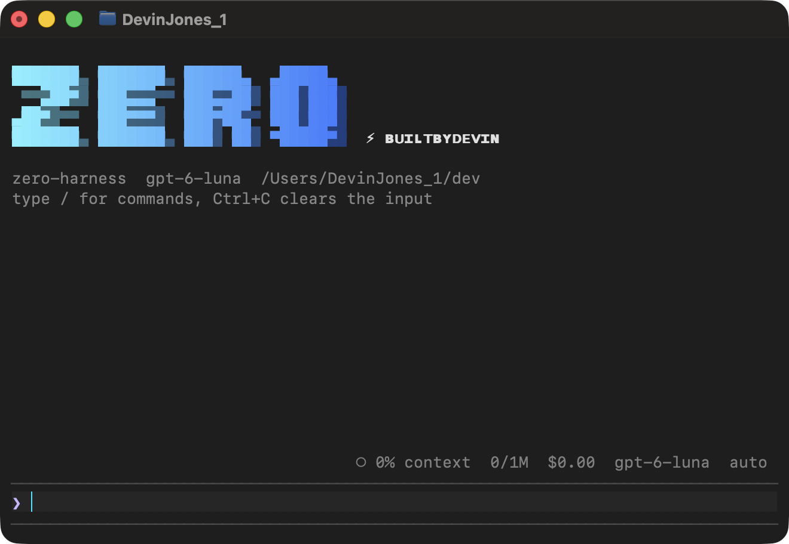

# zero-harness

A minimal terminal agent harness I built around OpenAI models. 
Designed for efficiency and reliability. <2,000 lines of Python, 8 tools, and a ~700-word system prompt. Unnecessary features? <kbd>**ZERO**</kbd>. **It can also fix itself.**



## Setup

Needs macOS, [uv](https://docs.astral.sh/uv/), and [ripgrep](https://github.com/BurntSushi/ripgrep).

```bash
uv tool install git+https://github.com/devinjones812/zero-harness
```

Put your keys in `~/.zero/.env` (see [`.env.example`](.env.example)). Only `OPENAI_API_KEY` is required. `PARALLEL_API_KEY` enables web search; `TYPESAFE_API_KEY` enables `auto` approvals.

Run `zero` in any directory to start.

## Features

- **Fixes itself.** When it falls short, with one command you can open a new zero in its own source code with a transcript of your session. That agent finds the cause, proposes fixes, and your conversation reloads with them in place.
- **Approvals that stay out of your way.** Jev approves routine commands, or turn it off and get asked only for known destructive commands like `rm -rf ~` and `git reset --hard`. At a prompt, type a reason instead of "no" and the agent changes course.
- **Steer it live.** Type while it works and it reads your message before its next step. Its thinking streams as it goes, so you can stop it early.
- **Long sessions.** It trims and summarizes context before the window fills. Every session is saved and resumable.

Tools: `bash`, `job`, `read_file`, `edit_file`, `grep`, `web_search`, `web_fetch`, `todo`.

## Commands

| Command | What it does |
| --- | --- |
| `/model` | Pick a model, then its reasoning effort. |
| `/effort <level>` | Set reasoning effort: `low`, `medium`, `high`, `xhigh`, `max`. |
| `/mode <mode>` | Set approvals: `ask`, `auto`, `auto-max`. |
| `/new` | Start a new session. |
| `/resume` | Continue a saved session. |
| `/undo` | Undo the last turn's file edits. Repeat to go further back. |
| `/summarize` | Replace the conversation with a summary to free up context. |
| `/title <title>` | Rename the session. |
| `/self-improve <note>` | Have a new zero find and fix what went wrong here. |
| `/reload` | Restart zero to apply code changes, keeping the conversation. |

Ctrl+E opens the input in `$EDITOR`. End a line with `\` for a newline.

## Hacking on zero

Clone the repo and run `uv tool install --editable .`. Code edits apply after `/reload`. `/self-improve` needs this install. To add a tool, create `src/zero_harness/tools/<name>.py` with a `SCHEMA` and a `run()`, then add it to `TOOLS` in `tools/registry.py`.

## License

MIT
